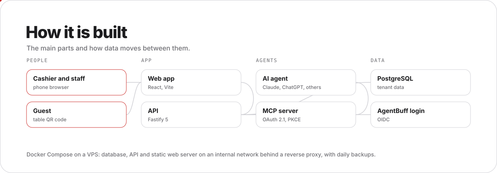
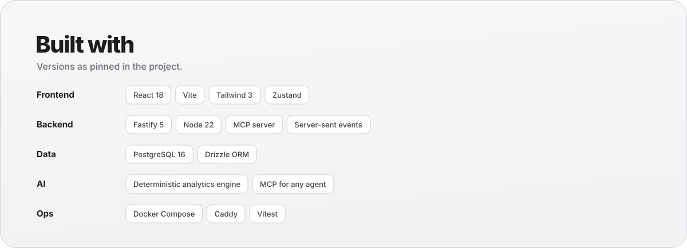
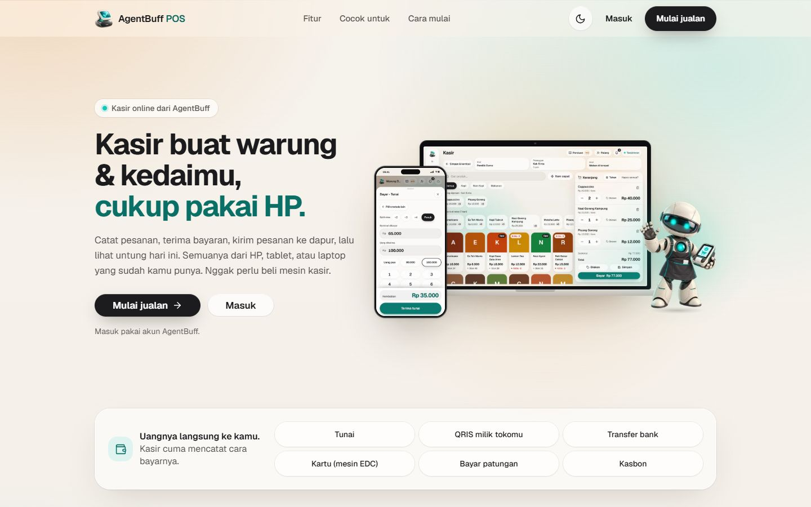

<!-- Showcase repository: the product is real and in use, its source code is private. -->

<a href="https://pos.agentbuff.id"><picture><source media="(prefers-color-scheme: dark)" srcset="assets/banner-dark.svg"></picture></a>

<a href="https://pos.agentbuff.id"><b>Open pos.agentbuff.id</b></a> · <a href="https://github.com/nugrahalabib">More of my work</a> · <a href="https://nugrahalabib.com">nugrahalabib.com</a> · <a href="mailto:nugrahalabib@gmail.com">Email</a>

## Overview

Kasir POS is a web point of sale for food and beverage, retail and service businesses in Indonesia. It runs on a phone, handles the cashier, kitchen and stock, and exposes the whole business as an MCP server.

Small shops lose money quietly: wild discounts, fake voids, cash gaps, stock nobody counts. Their sales data also sits inside vendor apps where no AI can reach it.

Any agent can read the shop's numbers through OAuth with PKCE. Anything that changes something is only a draft that a person approves in the app.

| | |
| --- | --- |
| **Status** | Live at [pos.agentbuff.id](https://pos.agentbuff.id) |
| **Role** | Designed, built and run by Nugraha Labib Mujaddid as a first-party app on the AgentBuff marketplace. |
| **Period** | Since Aug 2026 |
| **Source** | Private. This repository presents the product; the code is not published. |

<picture><source media="(prefers-color-scheme: dark)" srcset="assets/features-dark.svg"></picture>

Features as text

- **Cashier.** Catalog with modifiers, tiered discounts behind a PIN, split payments, QRIS, cash, card machine, transfer and store credit.
- **Kitchen display.** Orders reach the kitchen screen live, so the line sees every ticket the moment the cashier sends it.
- **Table QR self-order.** Guests scan a table code, order from their own phone and the order lands in the cashier and kitchen flow.
- **Inventory, recipes, COGS.** Recipes link menu items to stock, so cost of goods updates from what was really used.
- **Purchasing, price intelligence.** Record supplier purchases and spot when a price moves. Reports and a daily owner report link follow the numbers.
- **Staff and shifts.** Roles with permissions, PIN login, attendance, shift schedules and cash handover at the close of a shift.
- **CRM, loyalty, receivables.** Customer records, loyalty and a clear list of who owes the shop money.
- **Draft-only agents, audit trail.** Agent actions never touch a sale. Every change lands in an append-only audit trail.

<picture><source media="(prefers-color-scheme: dark)" srcset="assets/architecture-dark.svg"></picture>

<picture><source media="(prefers-color-scheme: dark)" srcset="assets/stack-dark.svg"></picture>

## Engineering highlights

- Agent tools are draft-only, and create, void, refund and checkout are on a forbidden list enforced in code.
- Analytics run in a deterministic engine with no LLM, so the numbers are repeatable.
- The audit trail is append-only, so no one can quietly rewrite what happened.
- The first screen loads about 0.2 MB of JavaScript, down from about 1.1 MB.

## Screens

Landing page

---

Built by [Nugraha Labib Mujaddid](https://github.com/nugrahalabib). This page describes a private codebase; questions about the product or a demo are welcome at [nugrahalabib@gmail.com](mailto:nugrahalabib@gmail.com).
