<!-- Showcase repository: the product is real and in use, its source code is private. -->

<a href="https://pos.agentbuff.id"><picture><source media="(prefers-color-scheme: dark)" srcset="assets/banner-dark.svg"></picture></a>

<a href="https://pos.agentbuff.id"><b>Open pos.agentbuff.id</b></a> · <a href="https://github.com/nugrahalabib">More of my work</a> · <a href="https://nugrahalabib.com">nugrahalabib.com</a> · <a href="mailto:nugrahalabib@gmail.com">Email</a>

<a href="#the-business">The business</a> · <a href="#product-tour">Product tour</a> · <a href="#for-developers">For developers</a>

## Overview

Kasir POS is a web point of sale for food and beverage, retail and service businesses in Indonesia. It runs on a phone, handles the cashier, kitchen and stock, and exposes the whole business as an MCP server.

Small shops lose money quietly: wild discounts, fake voids, cash gaps, stock nobody counts. Their sales data also sits inside vendor apps where no AI can reach it.

Any agent can read the shop's numbers through OAuth with PKCE. Anything that changes something is only a draft that a person approves in the app.

| | |
| --- | --- |
| **Status** | Live at [pos.agentbuff.id](https://pos.agentbuff.id) |
| **Role** | Designed, built and run by Nugraha Labib Mujaddid as a first-party app on the AgentBuff marketplace. |
| **Period** | Since Aug 2026 |
| **Source** | Private. This repository presents the product; the code is not published. |

<picture><source media="(prefers-color-scheme: dark)" srcset="assets/features-dark.svg"></picture>

## The business

Kasir POS is a web point of sale and back office for small Indonesian food and beverage, retail and service businesses. It runs on a phone, tablet or laptop and covers the cashier, kitchen screen, table QR ordering, stock with recipes and cost of goods, purchases, shifts, staff attendance and reports. The whole shop is also exposed as an MCP server, so the owner's own AI agent can read the numbers and propose actions that a person approves in the app. Nugraha Labib Mujaddid designed, built and runs it as CEO of AgentBuff, where it is sold as an app on the AgentBuff marketplace.

### The problem

Small shops lose money in ways nobody sees on the day: discounts given without a reason, sales voided after the customer paid, a cash drawer that is a little short at every close, and stock that runs out in the middle of lunch. Most owners find out weeks later, if ever.

Cost of goods is usually a guess. Ingredient prices move from one market trip to the next, so the real margin of a rice bowl or a coffee is unknown and price decisions come late.

At peak hours the cashier, the kitchen and the tables talk by shouting. Orders get lost, the wrong level of spice goes out, and guests wait to order because staff are busy.

The point of sale apps these shops use mostly record and display. The owner still reads every report alone, and the data stays inside the vendor app where no AI assistant can reach it.

### Who uses it

| Role | What they do with it |
| --- | --- |
| **Owner** | Sets up the menu, prices, recipes and staff, reads the daily report and the list of things that need attention, and approves anything an AI agent proposes with a PIN. |
| **Cashier** | Takes orders with options and notes, splits payments across cash, the shop's own QRIS, transfer, card machine or store credit, and opens and closes the cash shift. |
| **Kitchen and barista** | Works from a live kitchen screen, ticks items as they are cooked and sees which orders are running late. |
| **Manager** | Plans the weekly shift schedule, checks attendance, records shop purchases with receipt photos and follows up on cash differences. |
| **Guest** | Scans the QR code on the table, orders from their own phone without installing anything, and pays at the cashier. |
| **Owner's AI agent** | Reads sales, stock, margins and receivables over MCP and drafts reminders, price changes or stock adjustments. It cannot create, void or refund a sale. |

<picture><source media="(prefers-color-scheme: dark)" srcset="assets/before-after-dark.svg"></picture>

<picture><source media="(prefers-color-scheme: dark)" srcset="assets/journey-dark.svg"></picture>

<picture><source media="(prefers-color-scheme: dark)" srcset="assets/value-dark.svg"></picture>

### Model and status

Kasir POS is an app on the AgentBuff marketplace. A new store can only be created by an AgentBuff account that owns the product, through Sign in with AgentBuff. Staff accounts are created by the owner and are not checked against the marketplace.

While a store is in use, the owner's entitlement is checked with a short cache and a grace period. If access lapses the store is frozen in read-only form and the data is never touched; renewing opens it again on the next check.

No price is shown on the public page, so none is stated here. The app is live at pos.agentbuff.id, and a first cafe customer has used it for daily operations since September 2026.

## Product tour

### 1. Cashier

The cashier screen is a catalog on the left and a cart on the right. Each order starts with who serves, who the customer is and where the order comes from, so every sale carries that context into reports. Payment can be split across methods and the shop's own QRIS is confirmed by hand.

- Order intake: serving staff, saved customer or guest, dine in, takeaway or delivery app, table, party size
- Modifier groups with required and optional choices, price add-ons and a note for the kitchen
- Best sellers row, category filter, search and stock badges on each product card
- Payment by cash with change, the shop's static QRIS, bank transfer, card machine, or store credit with a due date
- Split by amount or by item; the remaining balance can become store credit for a saved customer
- Receipt by print, WhatsApp or email, sent by the cashier on request

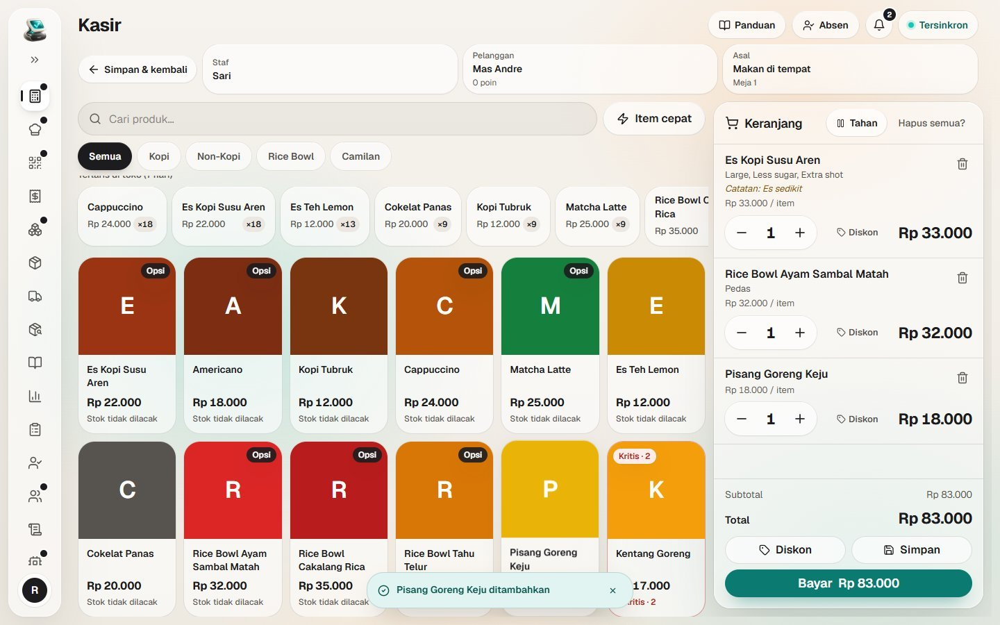

Catalog with best sellers and category filters, and a cart with options and kitchen notes for a dine-in order at table 1.

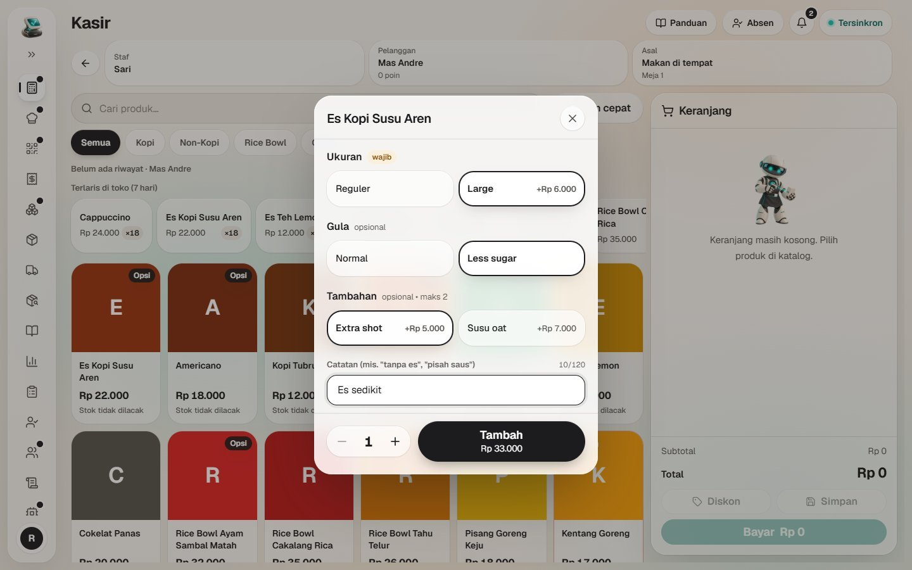 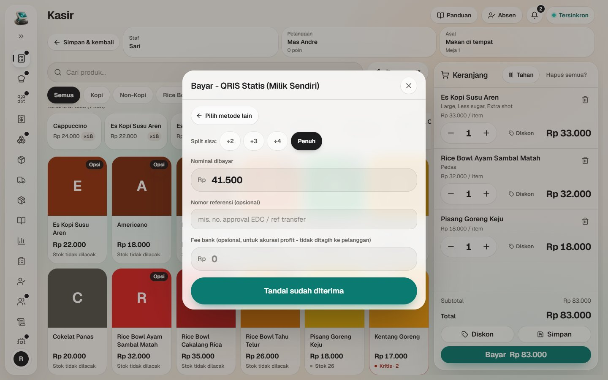

Left: Choosing size, sugar level, an extra shot and a kitchen note for an iced palm sugar coffee. · Right: Half of the bill already paid in cash; the rest goes to the shop's own QRIS and is marked as received by the cashier.

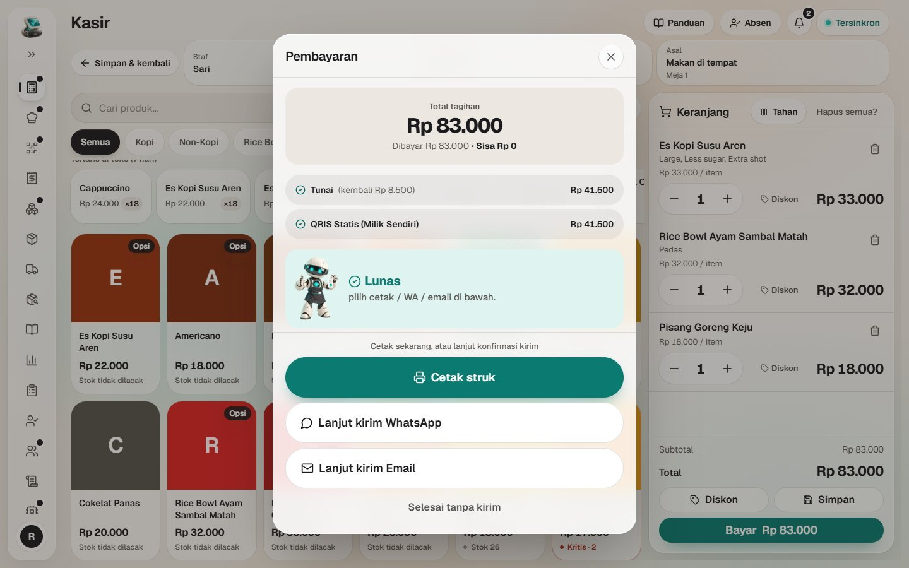

Both parts paid, change shown, and the receipt can be printed or sent by WhatsApp or email.

### 2. Phone-first cashier

The same cashier runs on a phone held in one hand. Product cards, the cart and the payment keypad are laid out for a 390 pixel wide screen with large touch targets and a bottom bar for the most used menus.

- Bottom navigation for cashier, kitchen, operations and stock
- Cart opens as a sheet with a running total and quick quantity buttons
- Cash keypad with split shortcuts and suggested notes

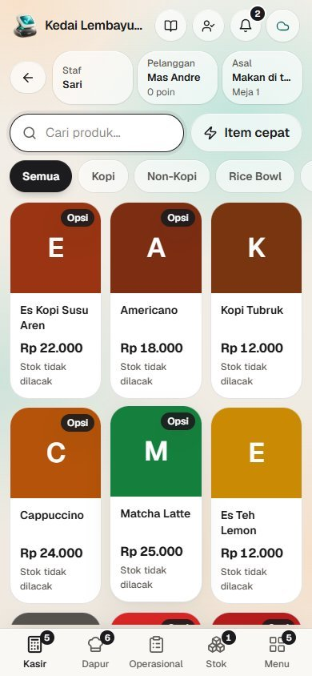

Phone catalog with the order context bar for staff, customer and table.

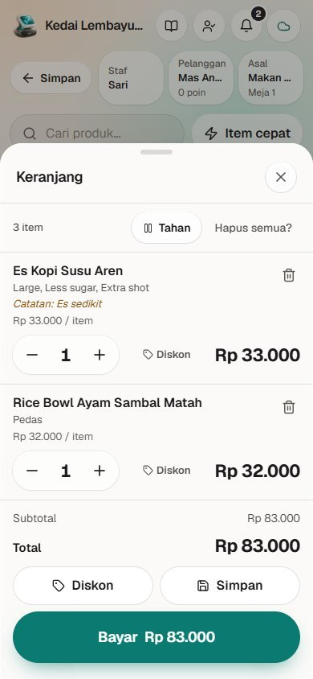 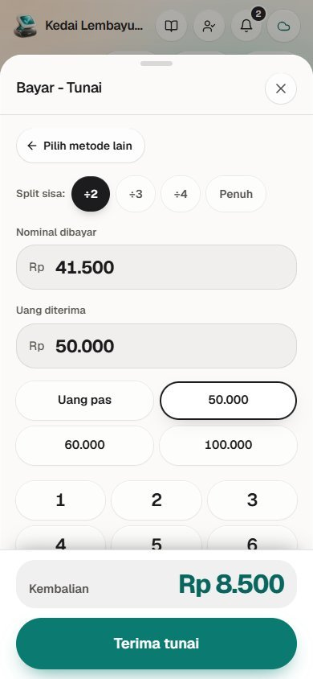

Left: Cart sheet on a phone with options, kitchen note and the pay button. · Right: Cash part of a split payment on a phone: half the bill, Rp 50.000 received, change calculated.

### 3. Kitchen display

Orders from the cashier, saved table orders and table QR orders all reach one live kitchen screen. Cooks tick each item through received, cooking and ready, and a timer turns a ticket red when it runs past the shop's limit.

- Three columns: received, cooking, ready to serve
- Per-item ticking, with an undo for a wrong tap
- Items routed to the kitchen or the bar station
- Unpaid and paid tickets marked, with the guest name and table
- Live updates over server-sent events

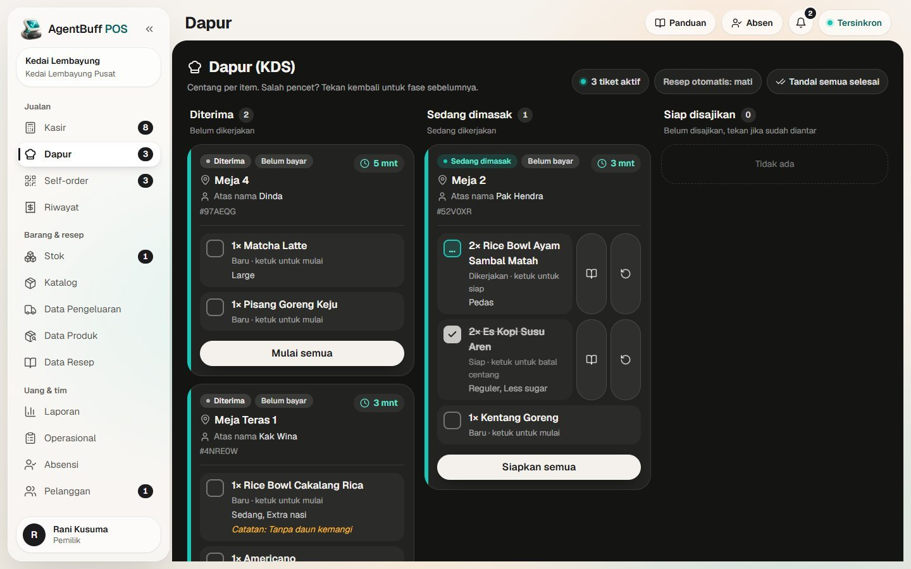

Kitchen screen with a table QR order, a saved table order and a ticket where the drinks are done and the rice bowls are cooking.

### 4. Table QR self-order

Each table has its own QR code. A guest opens the menu in the phone browser, picks items and options, gives a name and how they will eat, and sends the order to the kitchen. Payment always happens at the cashier.

- No app install and no sign in for the guest
- Same modifier groups as the cashier, with a note for the kitchen
- Guest can move to another active table before sending
- Status page shows when the kitchen has received the order
- Orders appear in the cashier inbox to be paid, alone or merged per table

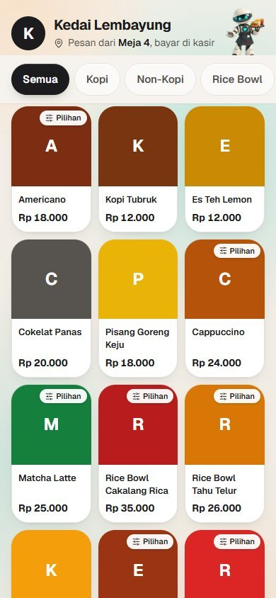

Guest menu opened from the QR code on table 4.

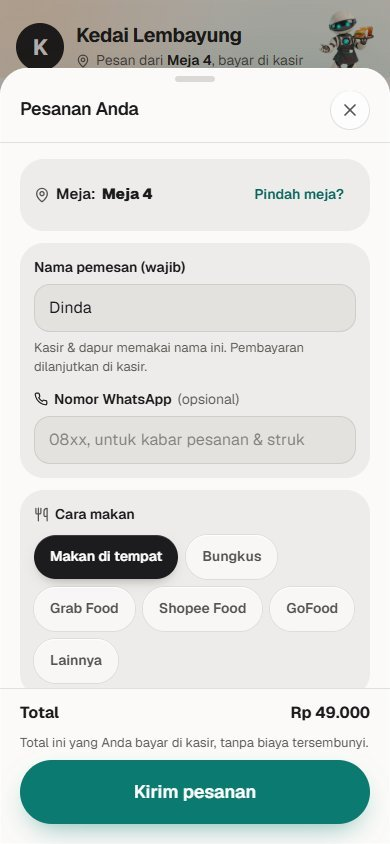 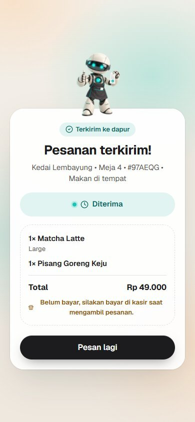

Left: Order sheet with the guest name, optional WhatsApp number and how they will eat. · Right: Confirmation that the order reached the kitchen, with the note to pay at the cashier.

### 5. Stock, recipes and cost of goods

Stock is kept as movements, never as an overwritten number. Ingredients carry a unit, a minimum level and the price paid at the last purchase. A recipe links a menu item to its ingredients, so each product shows its cost of goods and what is left after it.

- Product stock and raw ingredient stock in separate tabs
- Minimum levels and low stock badges on the cashier cards
- Cooking guides with ingredients, steps and tips linked to menu items
- Cost of goods per menu item from ingredient quantities and purchase prices

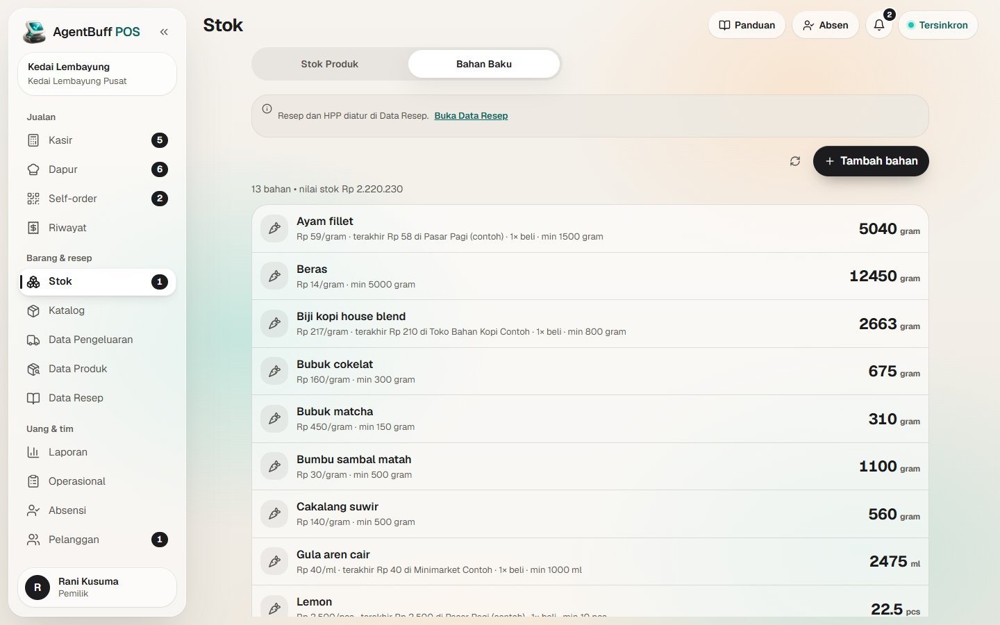

Raw ingredients with current stock, price per unit, last purchase and minimum level.

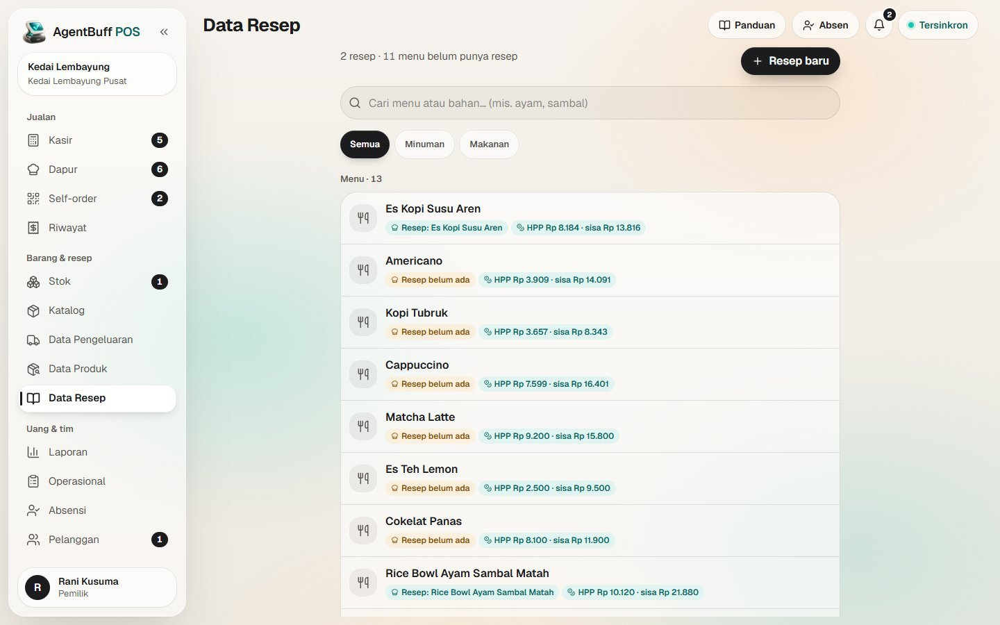

Recipe list with the cost of goods and remaining margin for each menu item.

### 6. Purchases and price check

Shop purchases are recorded as they really happen: who went, where, how it was paid and a photo of the receipt. Each line can raise ingredient stock, and the app compares the price with what the shop usually pays.

- Itemised purchases per staff member and per supplier
- Paid from the drawer, transfer, QRIS or a staff member's own money, settled later
- Price flagged when it is above the usual price, with the difference in percent
- Change checked against what the seller handed back
- A shift cannot close while a purchase still has no receipt photo

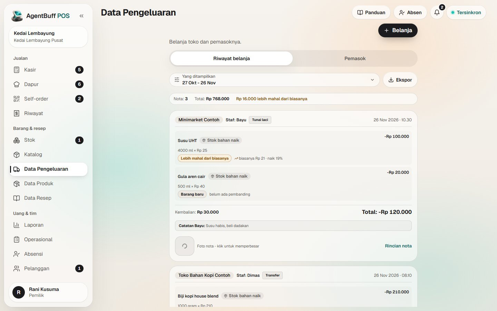

Purchase history where milk bought at a minimarket is flagged as 19% above the usual price.

### 7. Shifts, cash and staff

Each cash shift belongs to a named cashier. Closing it counts the drawer by denomination and compares it with expected cash, and a shortage becomes a record against that cashier. Staff clock in, and managers plan the week in a shift grid.

- Opening and closing counts by note and coin
- Cash handover check between shifts, with an explanation when amounts differ
- Shortage book for differences to be repaid or written off
- Weekly schedule with morning and afternoon shifts, days off and stand-ins
- Attendance with lateness against the schedule

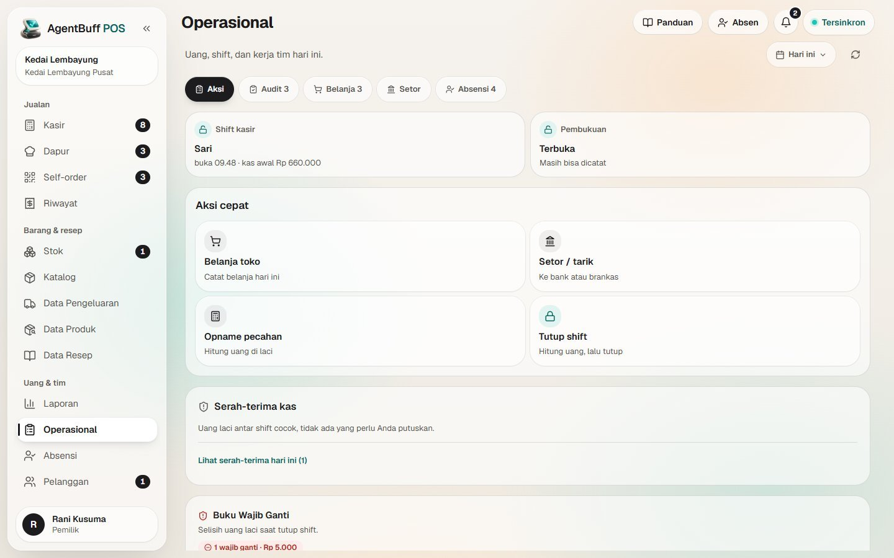

Operations page with the open shift, quick actions, the cash handover check and the shortage book.

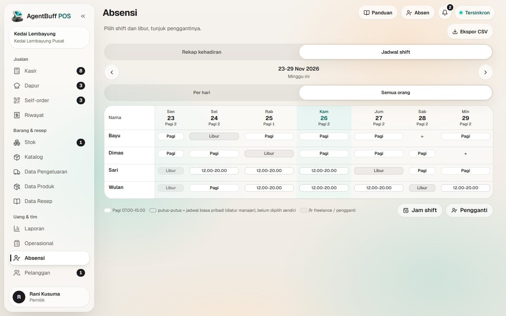

Weekly shift grid for four staff members with morning shifts, afternoon shifts and days off.

### 8. Reports and the owner's daily report

Reports are built by a deterministic analytics engine, not a language model. The daily report starts with what needs attention, then shows sales, transactions, average ticket, gross profit, peak hours, visitors and payment methods. A read-only link can be opened on the owner's phone or exported to PDF and Excel.

- Attention list: open shifts, unpaid orders, purchases above usual price, lateness, low stock, overdue store credit
- Net sales, transactions, average ticket and gross profit compared with yesterday and the 7-day average
- Peak hours, visitors per order, sales by payment method and order source
- Read-only daily report link marked as not final while a shift is still open

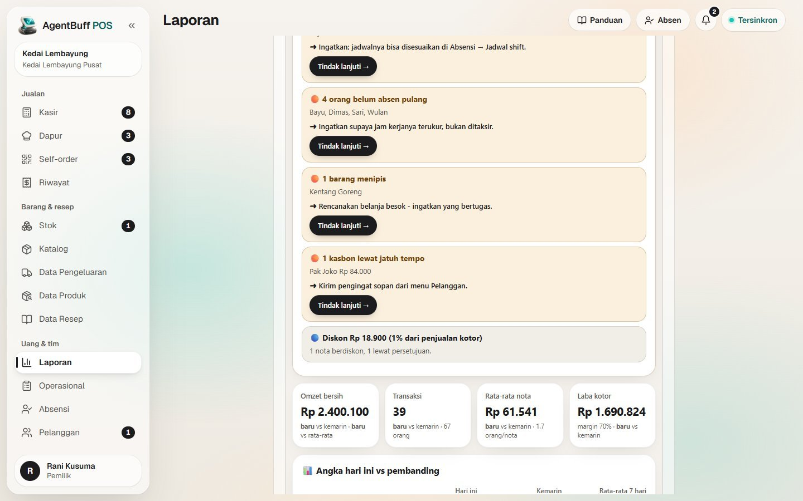

Today's report with the attention list and the four headline figures.

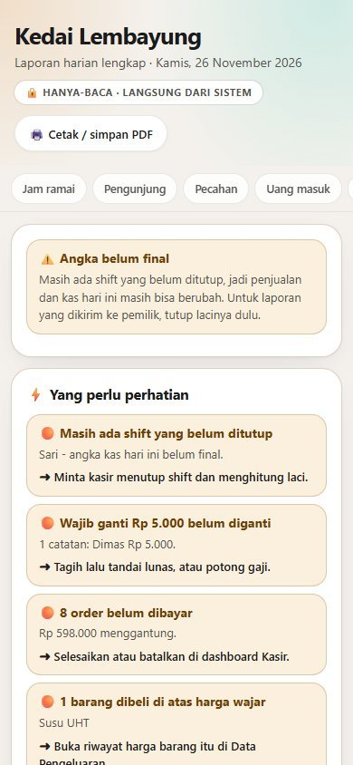

Read-only daily report opened from a link on the owner's phone.

### 9. Audit trail

Every change to money, stock, staff or settings is written to an append-only activity book with who did it, when and what changed. It cannot be edited or deleted, by the owner either.

- Who did what, with links to the transaction or shift
- Filter by person, group and date range
- Counter for entries without a known actor
- CSV export

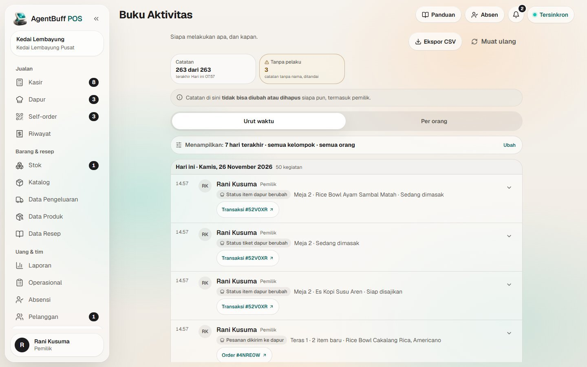

Activity book with kitchen status changes and orders sent to the kitchen, each with the actor and a link to the order.

### 10. AI agent over MCP

The owner connects any MCP agent, either by creating a scoped token or by approving a connection request from the agent. The agent reads the shop's data and can only create drafts; the owner approves or rejects each draft with a PIN. Every read, call and refusal is logged.

- Connection screen with the MCP address, the store audience and scope checkboxes
- Approvals queue with plain titles such as a proposed new price for a product
- Decision history: approved and executed, or rejected by the owner
- Action log showing reads, drafts and a refused attempt to void a transaction

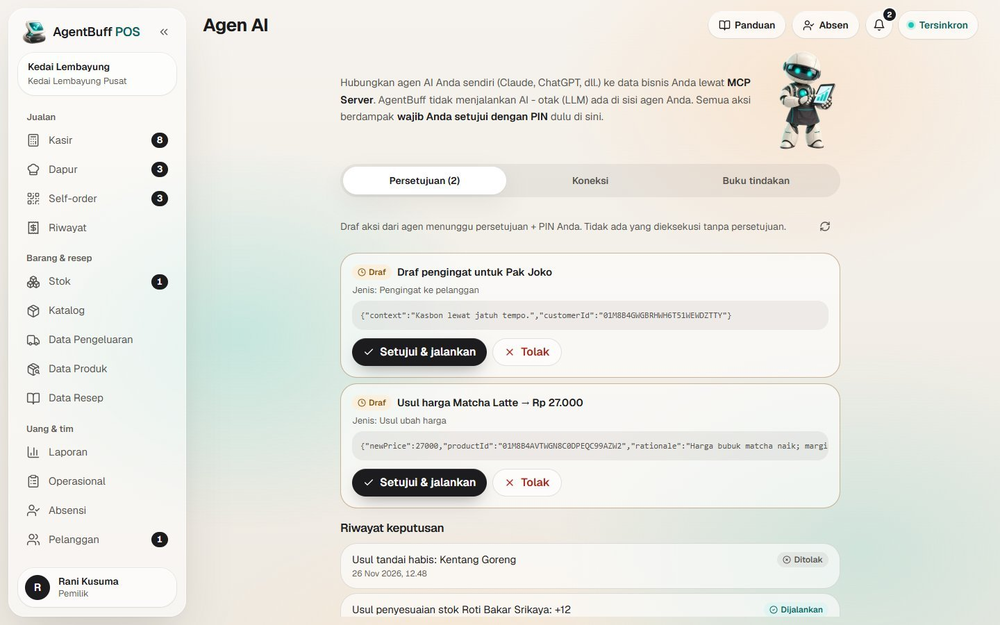

Drafts from the agent waiting for approval: a reminder for an overdue store credit and a price change, with past decisions below.

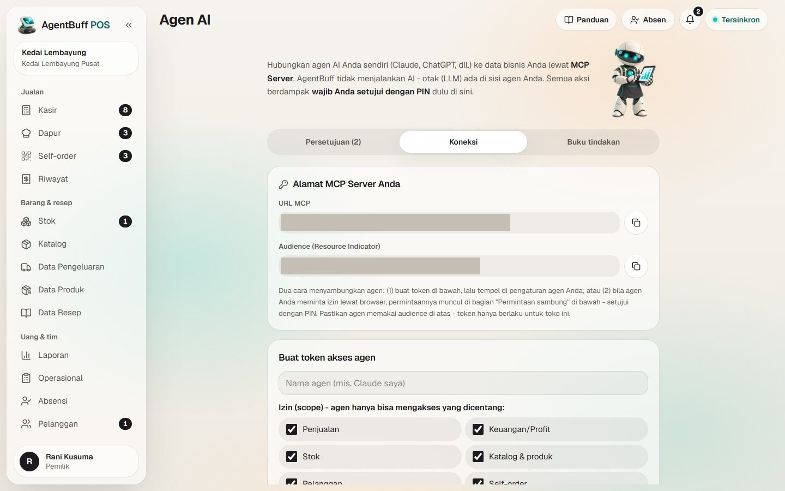 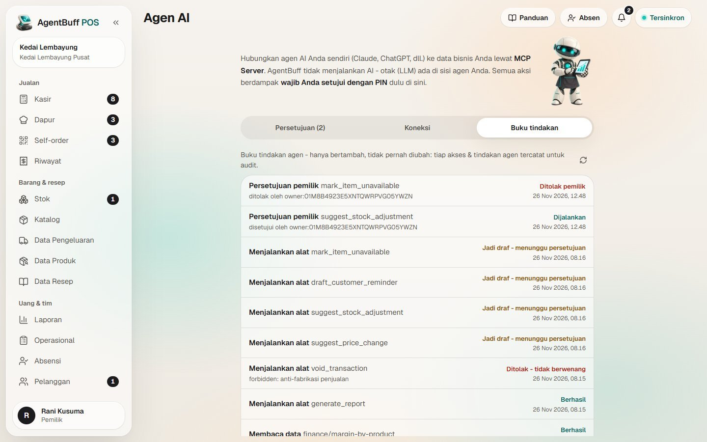

Left: Connection screen with scope checkboxes for a new agent token; the local MCP address and audience are masked. · Right: Append-only action log: owner decisions, draft tool calls, a refused void attempt and read-only report calls.

## For developers

### Architecture

Two TypeScript packages share one repository: a React 18 single page app built with Vite, Tailwind and Zustand, and a Fastify 5 API with Drizzle ORM on PostgreSQL. In development and tests the API runs on PGlite, an embedded PostgreSQL, so it starts without any external database.

The server is the authority on money. Amounts are integer rupiah, the client never decides a total, and the money and payment rules exist as identical copies on both sides, kept equal by parity tests. Checkout re-prices every line from the catalog and rejects a price or option that does not match.

The MCP server speaks JSON-RPC over HTTP. An agent reaches a store either at a per-store address or at one fixed address where the store is taken from the token itself. Access follows OAuth 2.1 with PKCE (S256), dynamic client registration (RFC 7591) and resource indicators (RFC 8707), so each token is bound to one store as its audience.

The MCP surface is small on purpose: 14 read-only resources (sales summary, transactions, sales by product, voids and refunds, profit estimate, margin by product, payments by method, inventory levels, catalog, customers, receivables, self-order summary, analytics alerts, store config), 6 tools and 5 prompts. Five tools only create drafts; generate_report is read-only. Seven scopes gate access, and the drafts scope is opt-in.

Six tool names that would change a sale (create_sale, delete_sale, void_transaction, refund_transaction, open_cash_drawer, checkout) are on a forbidden list in code and are refused and logged even if an agent asks for them. Resources and tools also follow the store's module switches, so an agent cannot read stock for a store that turned stock off.

Sign in with AgentBuff is an OIDC login. A marketplace gate checks the owner's entitlement at the door and while the store is used, and a server-to-server endpoint lets AgentBuff request a normal, revocable MCP token for the owner after purchase, using a short-lived ES256 signed assertion.

<picture><source media="(prefers-color-scheme: dark)" srcset="assets/architecture-dark.svg"></picture>

### Data model

<picture><source media="(prefers-color-scheme: dark)" srcset="assets/data-model-dark.svg"></picture>

### Key flows

<picture><source media="(prefers-color-scheme: dark)" srcset="assets/flow-1-dark.svg"></picture>

<picture><source media="(prefers-color-scheme: dark)" srcset="assets/flow-2-dark.svg"></picture>

<picture><source media="(prefers-color-scheme: dark)" srcset="assets/flow-3-dark.svg"></picture>

<picture><source media="(prefers-color-scheme: dark)" srcset="assets/flow-4-dark.svg"></picture>

<picture><source media="(prefers-color-scheme: dark)" srcset="assets/flow-5-dark.svg"></picture>

### Security

- The tenant id always comes from the session, never from the request body, and every query filters by tenant; isolation is covered by dedicated tests.
- Every sensitive route checks a permission on the server against the store's role matrix; hiding a menu is never the only guard.
- Passwords and PINs are hashed with scrypt; PIN attempts are limited to 10 per 5 minutes per store and address, and logins to 20 per 5 minutes per address.
- Agent tokens are stored hashed, bound to one store, limited to 120 calls per minute and expire after 90 days; tool arguments are capped at 16 KB.
- Side-effect tools only create drafts that need a PIN approval, and sale-changing tool names are refused in code and logged.
- Data from notes and names is treated as data in MCP responses, never as instructions, and every resource response states it comes from store data and not from a language model.
- The live kitchen stream uses short-lived one-time tickets instead of putting session tokens in URLs.
- The app never moves money: the shop's own static QRIS is confirmed by the cashier and payment classes that would process funds are rejected.
- Public self-order routes are rate limited per address and table token, and the demo store is only seeded in development or tests.

### Quality

- Web: 52 test files with 465 tests passing (changelog entry of 21 Oct 2026).
- Server: 114 test files under server/src run with Vitest against a real embedded PostgreSQL, including tenant isolation, money routes, MCP and the marketplace gate.
- Parity tests keep the server and client copies of money rules, status labels, dates and references identical.
- An automated sweep of 33 routes at two screen widths found 0 console errors and 0 failed requests (project notes, September 2026).
- First-load JavaScript was cut from about 1.1 MB to about 0.2 MB by loading each menu on demand.
- Architecture decisions are written down as ADRs 0001 to 0004.

### Deployment and operations

Docker Compose with three containers: PostgreSQL 16, the API on Node 22, and Caddy serving the built web app and routing the API, MCP, OAuth and report link paths to the API.

Database and API sit on a private internal network; only the web container joins the reverse proxy network.

The deploy script takes a backup first and aborts if it fails, counts rows in 13 key tables, deploys, waits for the health check, then recounts and raises an alarm if any table shrank.

The database is backed up daily and a written recovery runbook sits next to the deploy files.

New stores sign up through Google or Sign in with AgentBuff; email and password sign-up stays off in production.

### Decisions

| Decision | Why |
| --- | --- |
| Web app, online-first | One responsive web app for phone, tablet and laptop with no install. Only the cart in progress is kept locally to survive short drops. |
| TypeScript end to end on Fastify and PostgreSQL | Client and server must compute money the same way, so the money rules are shared code; PGlite keeps development and tests free of external services. |
| No payment gateway | The app records payments and never processes funds. QRIS is the shop's own static code, confirmed by the cashier, with no gateway fees. |
| Agents read, people approve | Agent tools can only create drafts, sale-changing tools do not exist, and every approval needs a PIN, so an agent can never fabricate or erase a sale. |
| Deterministic analytics, no LLM inside | Alerts and reports come from rules and statistics, so numbers repeat exactly and the app carries no inference cost; the owner's own agent does the language work. |
| Purchase orders removed | Shops buy at the market on the day, so real purchases with receipt photos replaced a formal purchase order flow that nobody used. |
| No automatic WhatsApp sending | Receipts and reports are sent by hand when a customer asks, which avoids a messaging gateway and unwanted messages. |

### Built with

<picture><source media="(prefers-color-scheme: dark)" srcset="assets/stack-dark.svg"></picture>

### Engineering highlights

- Agent tools are draft-only, and create, void, refund and checkout are on a forbidden list enforced in code.
- Analytics run in a deterministic engine with no LLM, so the numbers are repeatable.
- The audit trail is append-only, so no one can quietly rewrite what happened.
- The first screen loads about 0.2 MB of JavaScript, down from about 1.1 MB.

---

Built by [Nugraha Labib Mujaddid](https://github.com/nugrahalabib). This page describes a private codebase; questions about the product or a demo are welcome at [nugrahalabib@gmail.com](mailto:nugrahalabib@gmail.com).

## Related

- [AgentBuff](https://github.com/nugrahalabib/agentbuff-showcase)
- [Buff Your Money](https://github.com/nugrahalabib/agentbuff-bym-showcase)
- [KostCloud](https://github.com/nugrahalabib/agentbuff-kostcloud-showcase)
- [All my work on GitHub](https://github.com/nugrahalabib)
